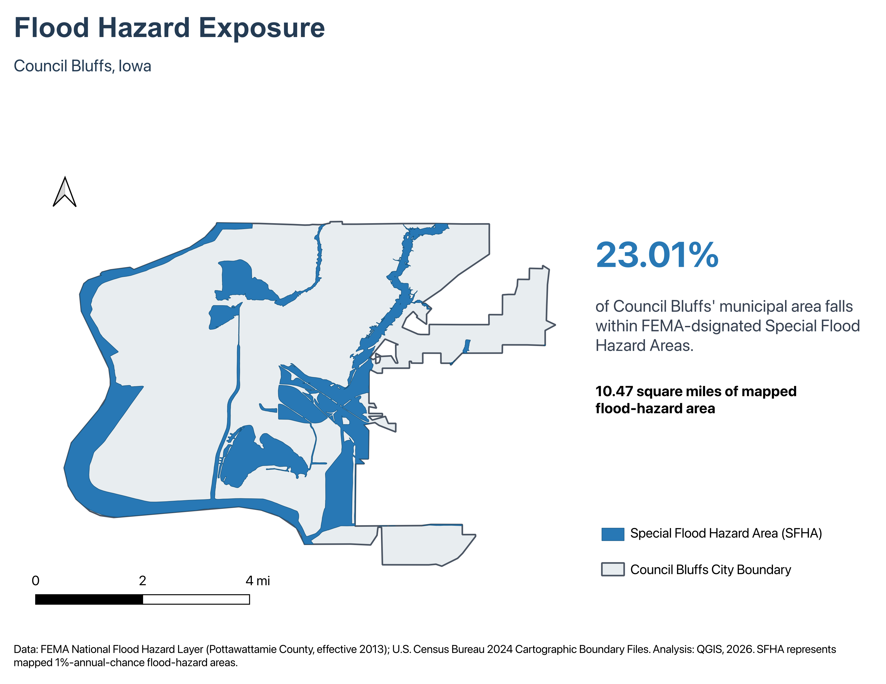

# Mapping Flood Exposure in Council Bluffs, Iowa

### A GIS-Based Environmental Analysis
# Mapping Flood Exposure in Council Bluffs, Iowa

## Project Overview

This project examines the geographic extent of FEMA-designated Special Flood Hazard Areas (SFHAs) within Council Bluffs, Iowa.

Using QGIS, FEMA's National Flood Hazard Layer (NFHL), and U.S. Census Bureau municipal boundary data, I analyzed how much of the city's mapped geographic area falls within designated flood-hazard zones.

The objective was to demonstrate how GIS can be used to process environmental datasets, perform spatial analysis, calculate geographic exposure, and communicate findings through professional cartographic visualization.

## Key Findings

- **23.01%** of Council Bluffs' mapped municipal area falls within FEMA-designated Special Flood Hazard Areas.
- Approximately **10.47 square miles** are classified as SFHA.
- The municipal study area covers approximately **45.49 square miles**.
- **53 SFHA polygon features** were identified before dissolving them into a combined flood-hazard footprint.

**Important:** These findings describe geographic exposure, not the percentage of residents, homes, or buildings affected by flooding.

## Tools and Technologies

- **QGIS 4.2.2** — Geographic data processing, spatial analysis, and cartographic design
- **GeoPackage (.gpkg)** — Storage and management of vector datasets
- **Vector geoprocessing** — Fix Geometries, Clip, Select by Expression, and Dissolve
- **Field Calculator** — Area measurements and geographic exposure calculations
- **EPSG:26976** — NAD83 / Iowa South coordinate reference system
- **QGIS Print Layout** — Professional map design and export

## Data Sources

### FEMA National Flood Hazard Layer (NFHL)

- **Source:** Federal Emergency Management Agency
- **Dataset:** NFHL_19155C
- **Coverage:** Pottawattamie County, Iowa
- **Effective study date:** April 16, 2013
- **Feature class:** S_FLD_HAZ_AR

[Explore FEMA's National Flood Hazard Layer](https://www.fema.gov/flood-maps/national-flood-hazard-layer)

### U.S. Census Bureau

- **Dataset:** 2024 Cartographic Boundary Files
- **Geography:** Iowa Places
- **Study area:** Council Bluffs, Iowa

[Explore U.S. Census Cartographic Boundary Files](https://www.census.gov/geographies/mapping-files/time-series/geo/cartographic-boundary.html)

## Methodology

The analysis was completed in QGIS using the following workflow:

1. **Municipal Boundary Preparation:** Imported the 2024 U.S. Census Bureau Iowa Places dataset and extracted the Council Bluffs municipal boundary.

2. **Coordinate Reference System:** Used NAD83 / Iowa South (EPSG:26976) for the project and area calculations.

3. **FEMA Data Import:** Imported flood-hazard polygons from the Pottawattamie County NFHL geodatabase.

4. **Geometry Repair:** Used the Fix Geometries tool to correct invalid FEMA polygon geometries encountered during processing.

5. **Spatial Clipping:** Clipped the repaired FEMA flood-hazard dataset to the Council Bluffs municipal boundary, producing 164 polygon features.

6. **SFHA Selection:** Selected features identified as Special Flood Hazard Areas using the expression:

   `"SFHA_TF" = 'T'`

7. **Dissolve Operation:** Dissolved the 53 selected SFHA polygons into a combined flood-hazard footprint.

8. **Area Calculation:** Calculated geographic area in square miles using the QGIS expression:

   `area($geometry) / 2589988.110336`

9. **Exposure Calculation:** Divided the mapped SFHA area by the municipal area to determine the percentage of the study area within designated flood-hazard zones.

10. **Cartographic Visualization:** Designed a map showing the city boundary, SFHA footprint, legend, scale bar, north arrow, key findings, and source attribution.

For a detailed technical explanation, see the [GIS Methodology Document](Methodology.md).

## Results

| Measurement | Result |
|---|---:|
| Council Bluffs municipal area | 45.4935 sq mi |
| FEMA-designated SFHA area | 10.4702 sq mi |
| Municipal area within SFHA | Approximately 23.01% |
| Selected SFHA polygon features | 53 |
| Clipped FEMA flood-zone features | 164 |

### Interpretation

Approximately **23% of Council Bluffs' mapped municipal area** falls within FEMA-designated Special Flood Hazard Areas.

These areas generally correspond to land with a 1% annual chance of flooding, often referred to as the 100-year floodplain.

The results provide a geographic perspective on mapped flood exposure and demonstrate how GIS can quantify environmental conditions within municipal boundaries.

## Final Map and Deliverables

The final map was developed in QGIS Print Layout and exported at 300 DPI for high-quality digital and print presentation.

- [View Full-Resolution Flood Exposure Map (PNG)](Council_Bluffs_Exposure_Map.png)
- [View Printable Flood Exposure Map (PDF)](Council_Bluffs_Exposure_Map.pdf)
- [Read Detailed GIS Methodology](Methodology.md)

## Limitations

Several limitations should be considered when interpreting these results:

- **Flood-hazard data age:** The FEMA county dataset used in this analysis is associated with an April 16, 2013 effective study date. Subsequent map revisions may affect the current mapped flood-hazard extent.
- **Geographic exposure only:** This analysis measures land area rather than the number of residents, buildings, or infrastructure assets potentially affected.
- **Flooding outside SFHA boundaries:** Flooding can occur outside FEMA-designated Special Flood Hazard Areas.
- **Boundary generalization:** The 2024 Census cartographic boundary dataset is generalized and may differ from more detailed municipal boundary datasets.
- **Scope:** This project does not model flood depths, flood velocities, economic losses, or evacuation impacts.

## Future Analysis Opportunities

This project could be expanded through additional GIS analysis, including:

- **Building exposure:** Overlaying building footprints with SFHA boundaries to identify potentially exposed structures.
- **Population exposure:** Incorporating Census demographic data to estimate populations living within mapped flood-hazard areas.
- **Transportation vulnerability:** Identifying road segments and transportation corridors intersecting SFHA boundaries.
- **Critical infrastructure:** Evaluating the proximity of hospitals, schools, utilities, and emergency facilities to mapped flood hazards.
- **Flood-risk communication:** Developing interactive web maps and dashboards for public-facing visualization.

## Project Summary

This project demonstrates practical experience in GIS data acquisition, spatial processing, geometry validation, attribute-based selection, area calculations, and cartographic communication.

By combining federal flood-hazard data with municipal geographic boundaries, I produced a reproducible spatial analysis that translates complex environmental data into a clear, measurable finding.

**Software:** QGIS 4.2.2

**Analysis completed:** November 2026

**Study area:** Council Bluffs, Iowa
